# ha-solar-forecast-card

[](https://www.home-assistant.io/integrations/marketplace/)
[](https://github.com/juju35/ha-solar-forecast-card/actions/workflows/hacs.yml)
[](https://github.com/juju35/ha-solar-forecast-card/actions/workflows/validate.yml)
[](https://github.com/juju35/ha-solar-forecast-card/actions/workflows/lint.yml)
[](https://github.com/juju35/ha-solar-forecast-card/releases/latest)
[](https://github.com/juju35/ha-solar-forecast-card/blob/main/LICENSE)
[](https://buymeacoffee.com/julienstep9)

<p align="center">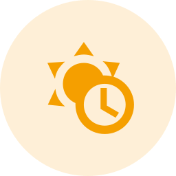</p>

<p align="center">
  &nbsp;&nbsp;
  &nbsp;&nbsp;
  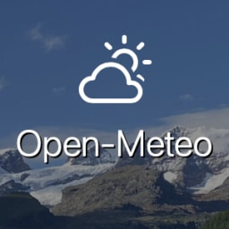
</p>

A Lovelace card for **solar production forecasts**: today's forecast curve against the actual production, the energy still to come, tomorrow's total and the best time to run the dishwasher or charge the car.

[](https://my.home-assistant.io/redirect/marketplace_repository/?owner=juju35&repository=ha-solar-forecast-card&category=plugin)

| Card | Type | What it shows |
|---|---|---|
| [Solar forecast](#screenshots) | `custom:solar-forecast-card` | Today's forecast against the actual production, tomorrow's total and the best window to run appliances. |
| [Solar forecast mini](#solar-forecast-mini) | `custom:solar-forecast-mini-card` | Today's and tomorrow's forecast on two lines, with a zoom to the full card. |

| On track | Below the forecast |
|---|---|
| 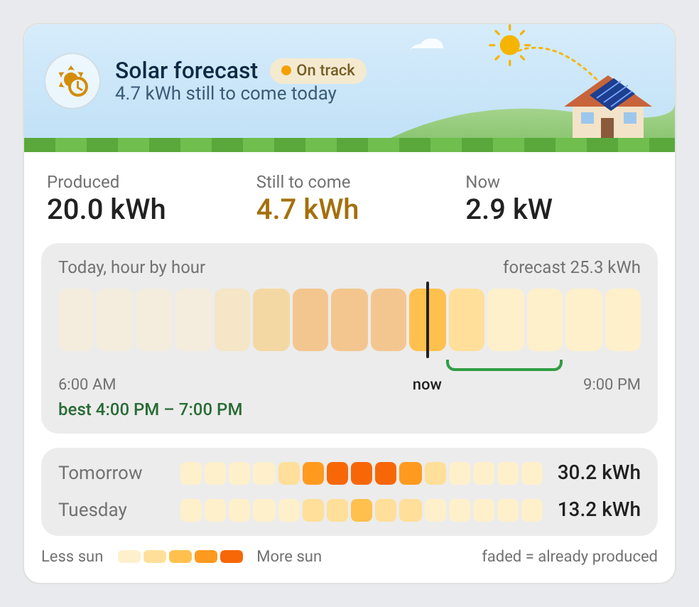 | 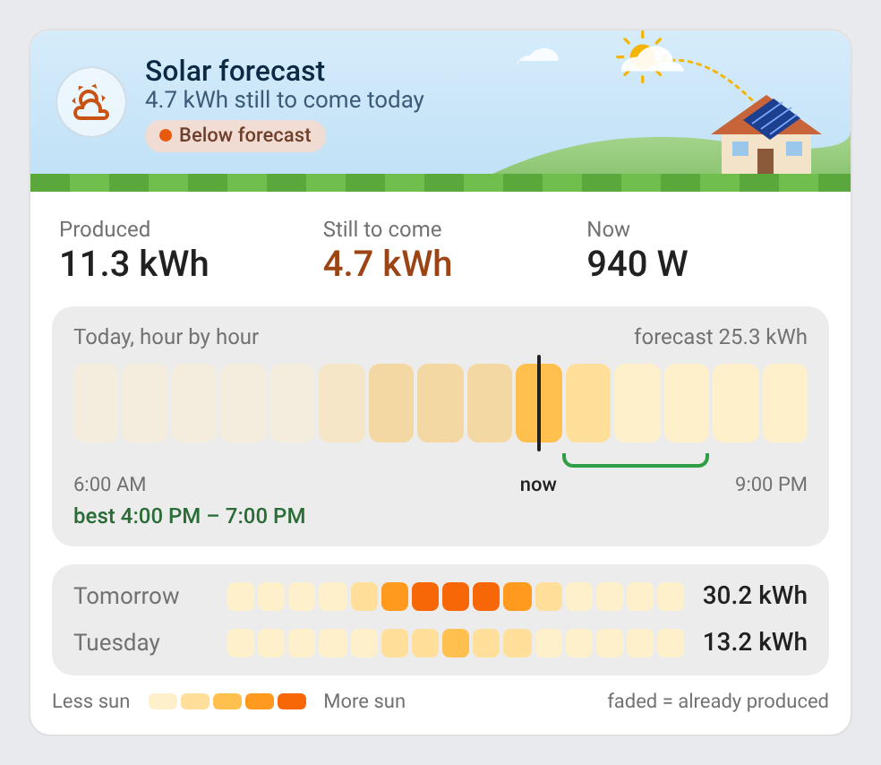 |

## Features

- **Today hour by hour**: a ribbon of the hours with sun, each cell coloured by the energy of its hour (lighter: less sun, deeper orange: more), the hours already produced faded and coloured by the actual production, a marker at the time of day
- **The best time to run appliances**: the hours in a row (`window_hours`, 3 by default) with the most forecast energy left today, bracketed under the ribbon; once the sun is gone, tomorrow's
- **Produced, still to come, now**: today's actual production (from the recorder), the forecast energy still to come today, and the power now (the panels' power sensor, else the forecast power)
- **On track, above or below**: the status compares what was produced with what the forecast expected so far (above 110 %, on track from 85 %, below under that); by night, tomorrow's forecast
- **The next days**: tomorrow and the day after as thinner ribbons with their totals
- **Illustrated header**: a house with its panels on a sunny hill; the sun follows its arc through the day and its light runs down to the panels while they produce, a cloud covers it below the forecast, the moon and the stars come out by night; the dark theme darkens the picture
- **Mini card**: the share of today's forecast already produced as a ring around the badge, the state, what is still to come and tomorrow; its zoom button opens the full card in place
- **Tap a number** to open its sensor's history
- Visual editor for both cards, light and dark themes, 22 languages, no external dependency

## Supported integrations

The card reads the forecast sensors of these integrations. Their hour by hour forecast comes from the sensors' attributes when they carry it (Solcast, Open-Meteo), else from the **Energy dashboard** (add the forecast to its solar panels). The actual production comes from the recorder's statistics of the panels' energy sensor: the Energy dashboard's solar source, or `production`.

| | Integration | What the cards show |
|:---:|---|---|
|  | [Forecast.Solar](https://www.home-assistant.io/integrations/forecast_solar/) (built in) | Forecast for today and tomorrow, power now and next hour, peak time |
|  | [Solcast PV Forecast](https://github.com/BJReplay/ha-solcast-solar) (Marketplace) | Detailed forecast with P10 / P90 estimates, today, tomorrow and the next days |
|  | [Open-Meteo Solar Forecast](https://github.com/rany2/ha-open-meteo-solar-forecast) (Marketplace) | Free forecast with no account, today and the next days |

## Installation

### Via the Marketplace (recommended)

Click the button below to add the repository directly:

[](https://my.home-assistant.io/redirect/marketplace_repository/?owner=juju35&repository=ha-solar-forecast-card&category=plugin)

Or manually:

1. Open **Settings → Marketplace → Add from link** (top right; this needs a GitHub account connected)
2. Add `https://github.com/juju35/ha-solar-forecast-card` — Type: **Dashboard**
3. Open **Solar Forecast Card** and click **Install**
4. Clear your browser cache and refresh

The Marketplace registers the dashboard resource for you.

### Manual

1. Download `ha-solar-forecast-card.js` and the `ha-solar-forecast-card.i18n.*.js` translation files from the [latest release](https://github.com/juju35/ha-solar-forecast-card/releases/latest)
2. Copy them all to `/config/www/` (without the translation files, the cards show in English)
3. Go to **Settings → Dashboards → Resources** → Add resource:
   - URL: `/local/ha-solar-forecast-card.js`
   - Type: **JavaScript Module**
4. Clear your browser cache and refresh

## Configuration

Every option is in the visual editor. In YAML:

```yaml
type: custom:solar-forecast-card
entity: sensor.energy_production_today

# With the panels' own sensors, and a 2-hour window for the best time
type: custom:solar-forecast-card
entity: sensor.energy_production_today
production: sensor.inverter_energy_total
power: sensor.inverter_power
window_hours: 2

# Two lines on a phone dashboard
type: custom:solar-forecast-mini-card
entity: sensor.solcast_pv_forecast_forecast_today

# A role the discovery missed
type: custom:solar-forecast-card
entity: sensor.energy_production_today
entities:
  tomorrow: sensor.energy_production_tomorrow_roof
```

| Option | Type | Default | Description |
|---|---|---|---|
| `entity` | string | the first forecast found | Any sensor of the forecast integration; its other sensors are found on the same device |
| `title` | string | `Solar forecast` | Card title |
| `show_title` | boolean | `true` | Both: show the title |
| `show_subtitle` | boolean | `true` | Both: what is still to come today (by night: tomorrow) under the title |
| `navigation_path` | string | | Both: a tap on the header opens this dashboard path |
| `production` | string | the Energy dashboard's solar source | The panels' energy sensor (kWh) for the actual production, hour by hour |
| `power` | string | | The panels' power sensor (W) for the power now (else the forecast power) |
| `window_hours` | number | `3` | The length of the best time window, 1 to 6 hours |
| `show_days` | boolean | `true` | Tomorrow and the day after |
| `illustration` | boolean | `true` | Both: the illustrated header (`false`: the classic header) |
| `illustration_theme` | string | `auto` | Both: `auto` (follows the Home Assistant theme: night with a dark theme, day with a light theme), `day` or `night` |
| `animations` | boolean | `true` | Both: the sun's rays and its light running to the panels |
| `zoom` | boolean | `true` | Mini card: the zoom button |
| `entities` | map | | Advanced (YAML only): the sensor of a role, over the discovery — `today`, `remaining`, `tomorrow`, `day3`, `now`, `peak` |
| `language` | string | Home Assistant's | Advanced: one of the [languages](#translations) |

## Screenshots

| On track | Above the forecast | Below the forecast |
|---|---|---|
|  | 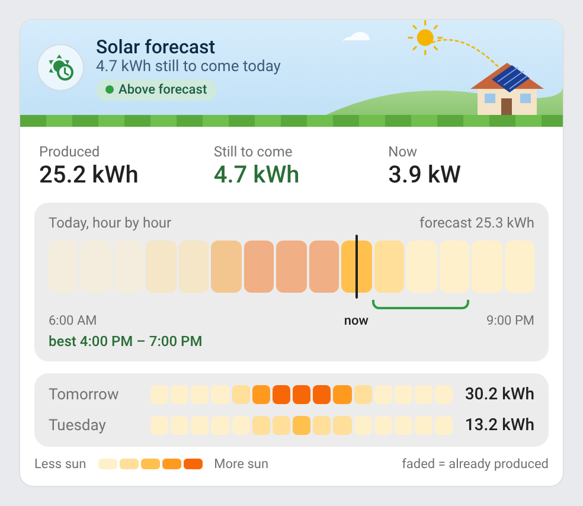 |  |
|  | 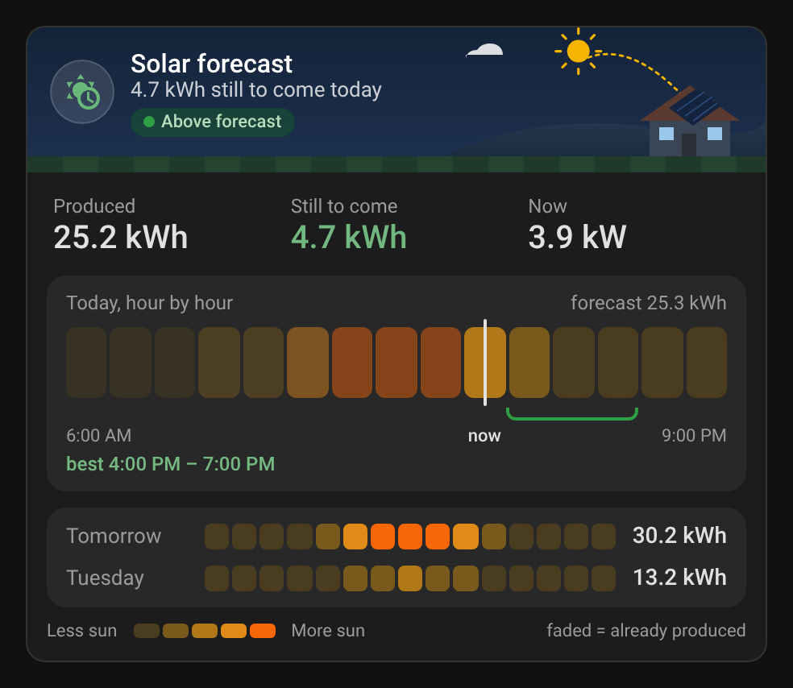 | 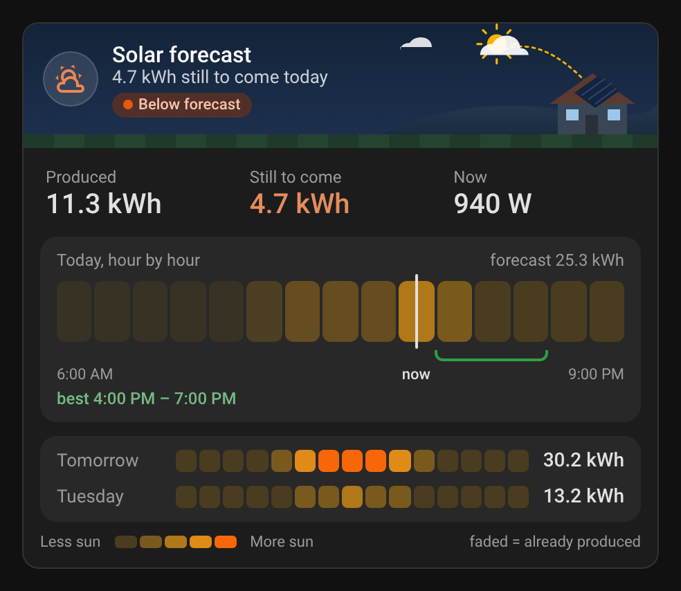 |

| Night (tomorrow's best time) | Sensors only (no hour by hour forecast) | Narrow |
|---|---|---|
| 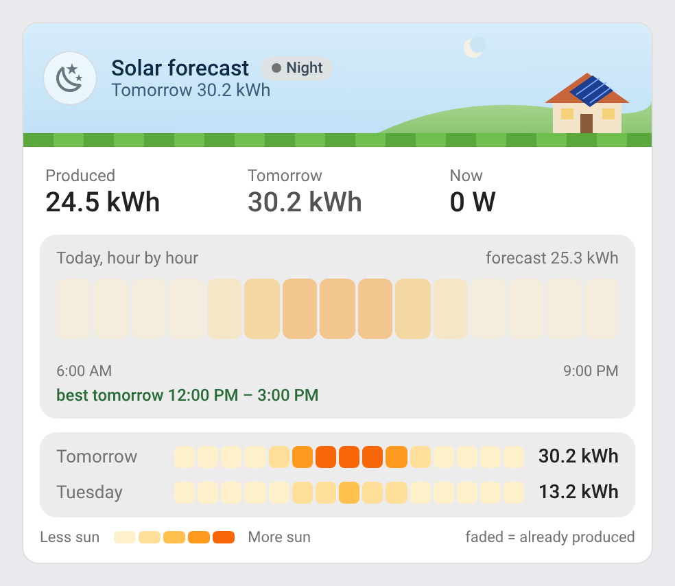 | 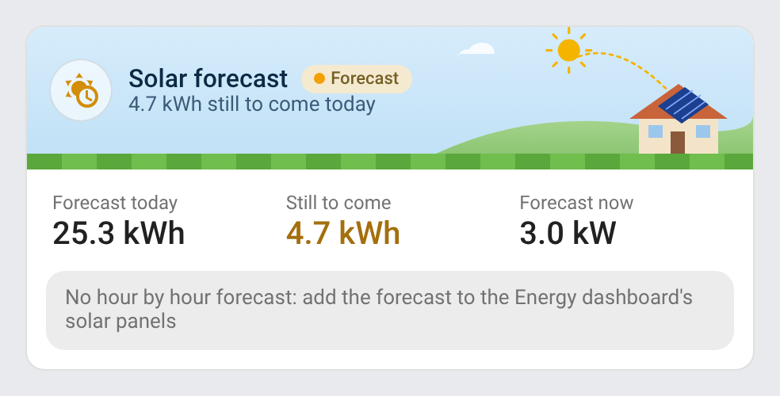 | 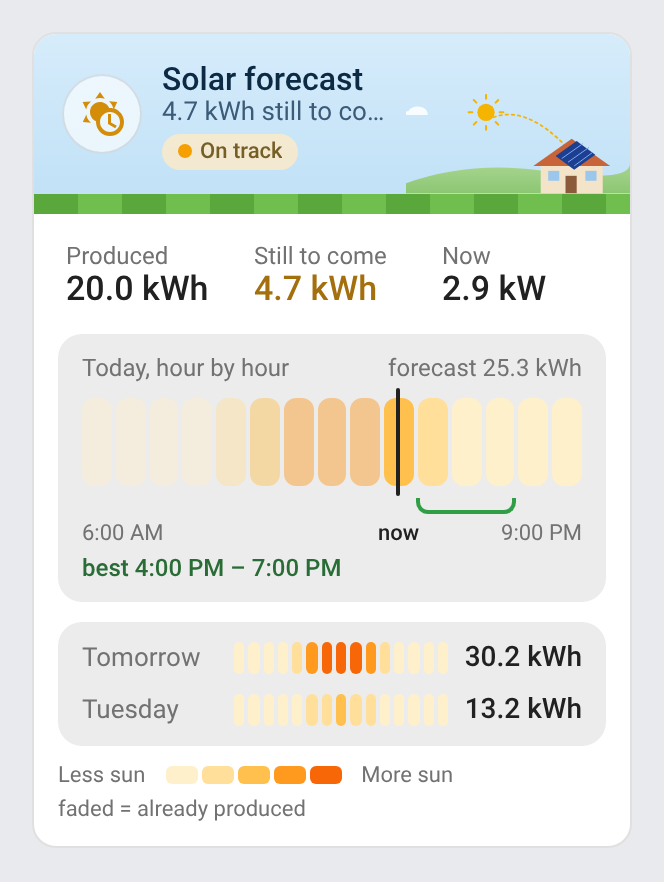 |
| 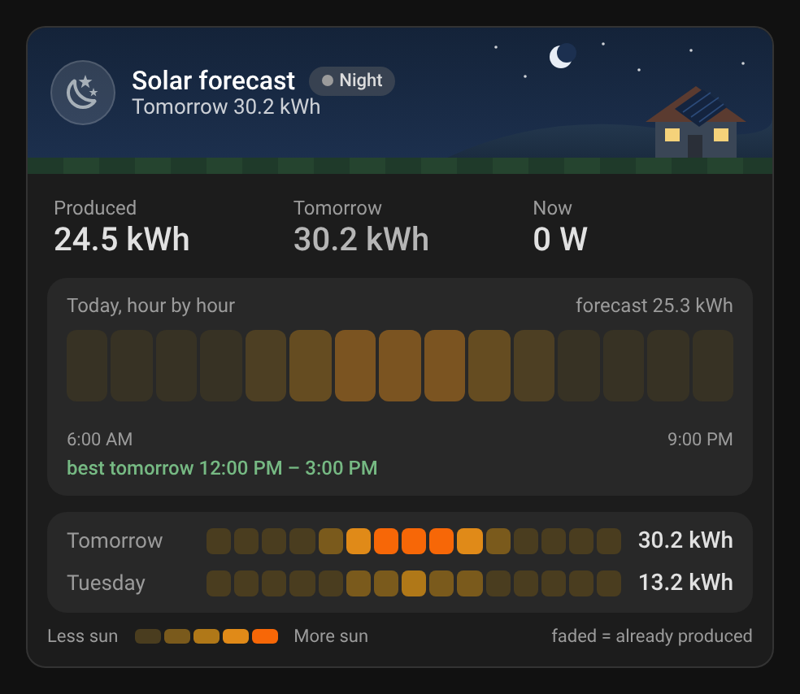 | 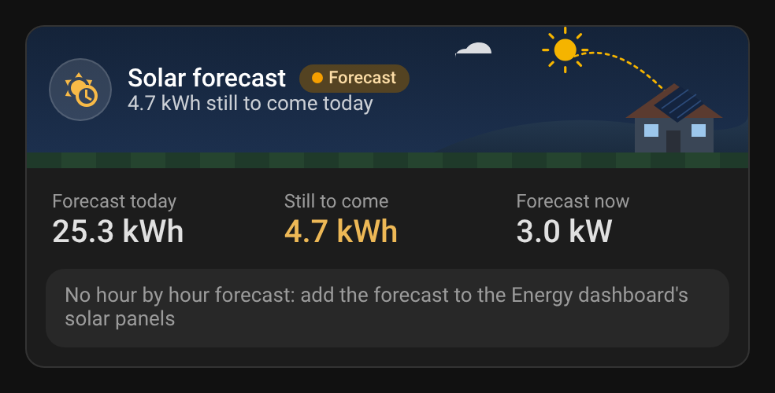 | 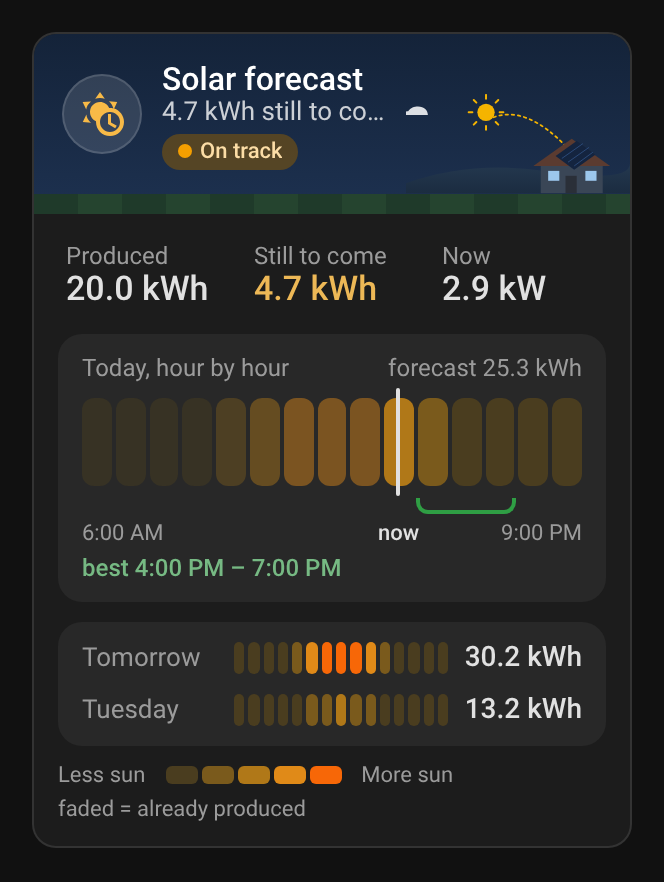 |

**Producing animation**: the sun's rays turn and its light runs down to the panels while they produce (still with `animations: false`, or when the system asks for reduced motion).

| Light | Dark |
|---|---|
| 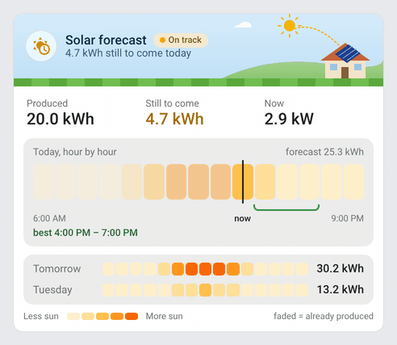 | 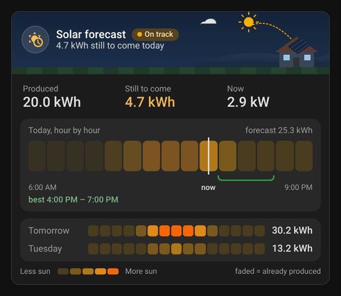 |

### Solar forecast mini

| Producing | Night | Zoomed in |
|---|---|---|
| 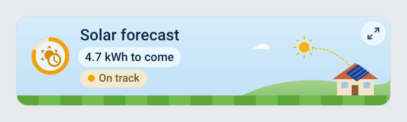 | 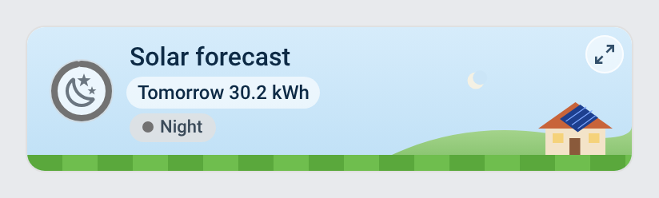 | 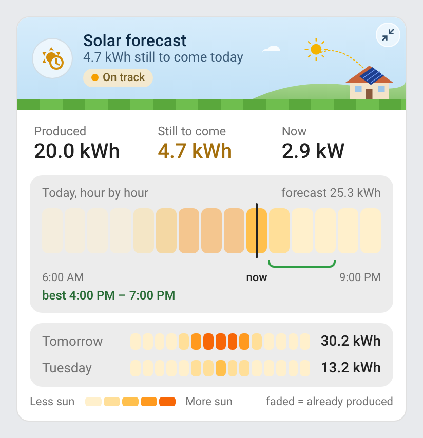 |
| 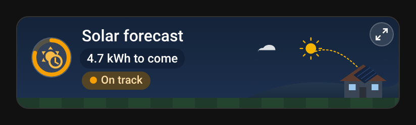 | 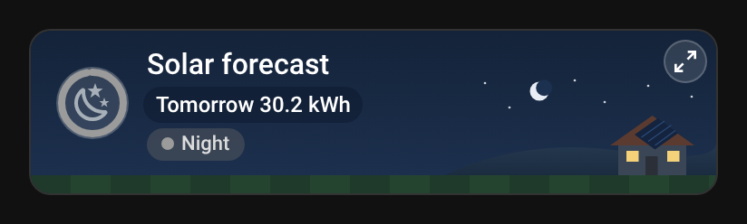 | 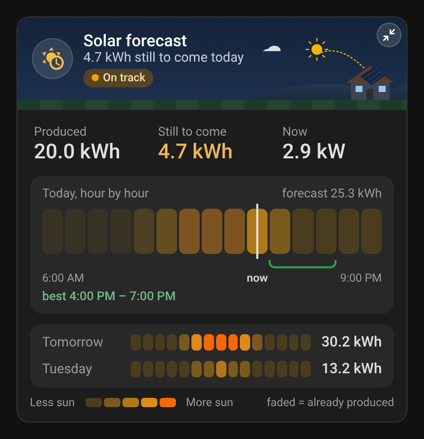 |

| Producing animation | Dark |
|---|---|
| 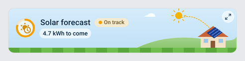 | 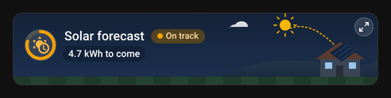 |

## How it works

- **Forecast**: `entity`, else the first *energy production today* sensor of Forecast.Solar, Solcast or Open-Meteo Solar Forecast; the other roles on its device by their translation key or entity id: `today`, `remaining`, `tomorrow`, `day3` (Solcast), `now` (the power now), `peak` (the peak time); `entities` sets any of them
- **Hour by hour**: Solcast's `detailedHourly` / `detailedForecast` and Open-Meteo's `wh_period` attributes, else the Energy dashboard's forecast (`energy/solar_forecast`, the forecasts of its solar panels added up); without either, the card shows the numbers and a hint
- **Production**: the hourly `change` of the production sensor's statistics since midnight (`recorder/statistics_during_period`), fetched at first, every 10 minutes and at each new hour; the sensor is `production`, else the Energy dashboard's solar source
- **Status**: produced against the forecast so far (today's forecast minus what is still to come) once 0.2 kWh were expected: above 110 %, on track from 85 %, below under that; *Night* while `sun.sun` is below the horizon; *Forecast* without a production
- **Best time**: the `window_hours` hours in a row with the most forecast energy, from the next hour once a quarter of this one has gone; when none is left today, tomorrow's
- **Read only**: the card calls no action

## Development

```bash
npm install
npm run build        # stamps the version of package.json into dist/ha-solar-forecast-card.js
npm run check        # builds and checks the bundle (run in CI)
npm test             # unit tests
npm run screenshots  # renders the cards with a mock forecast into screenshots/ (and the GIFs, needs ffmpeg)
```

`dist/` is not committed: `npm run build` creates it locally, CI builds it on every push, and the release workflow attaches the built files to the release, which is where the Marketplace installs them from.

### Releasing

1. Bump `version` in `package.json`
2. Add a `## <version>` section at the top of [CHANGELOG.md](https://github.com/juju35/ha-solar-forecast-card/blob/main/CHANGELOG.md)
3. Push to `main`: the **Release** workflow builds the card, creates the tag and the GitHub release with the changelog section as notes, and attaches `ha-solar-forecast-card.js` and its translation files

## Translations

The card auto-detects the language from your Home Assistant settings. Currently supported:

| Language | Code |
|---|---|
| English | `en` |
| Français | `fr` |
| Deutsch | `de` |
| Español | `es` |
| Српски | `sr` |
| Srpski (latinica) | `sr-Latn` |
| Italiano | `it` |
| Nederlands | `nl` |
| Português (Portugal) | `pt` |
| Polski | `pl` |
| Română | `ro` |
| Dansk | `da` |
| Svenska | `sv` |
| Български | `bg` |
| Русский | `ru` |
| Українська | `uk` |
| Magyar | `hu` |
| Slovenčina | `sk` |
| Čeština | `cs` |
| Slovenščina | `sl` |
| Latviešu | `lv` |
| Ελληνικά | `el` |

Contributions for additional languages are welcome!

## License

[MIT](https://github.com/juju35/ha-solar-forecast-card/blob/main/LICENSE)

## Support

If you find this project useful, you can support its development:

<a href="https://buymeacoffee.com/julienstep9"></a>
